<div align="center">

# 🏠 IoT Wall Outlet with Raspberry Pi and ESP8266

**An ESP32-based smart outlet and room monitor: control a lamp and a fan from four different interfaces and watch temperature, humidity and light from anywhere**


<br/><br/>

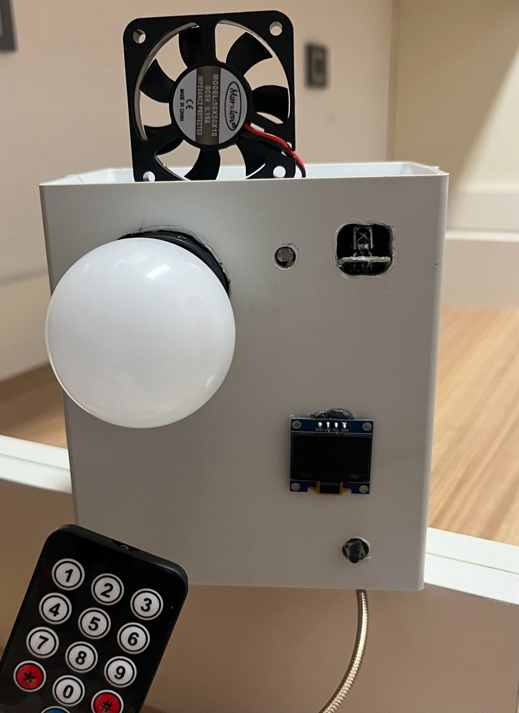

<sub><i>The finished device: lamp, fan, OLED status screen, push button and IR remote in one enclosure.</i></sub>

</div>

---

## 📌 Overview

This project turns an ordinary lamp and fan into **smart, connected devices**. An **ESP32** switches both loads through **relays** and reads the room's **temperature, humidity (DHT11)** and **light level (LDR)**. A **Raspberry Pi** runs the **Mosquitto MQTT broker** and **Node-RED**, which act as the central communication and control unit.

The lamp and fan can be controlled in **four different ways**:

| | Interface | Path |
|:---:|---|---|
| 🔘 | **Physical button** | ESP32 GPIO → relay (works without any network) |
| 📺 | **IR remote** | IR receiver → ESP32 → relay |
| 📱 | **IoT MQTT Panel mobile app** | Phone → Mosquitto → ESP32 |
| 🖥️ | **Node-RED Dashboard** | Browser → Node-RED → Mosquitto → ESP32 |

Sensor data is shown **locally on an OLED screen**, **live on the Node-RED Dashboard**, logged to **ThingSpeak** for history charts, and lamp/fan changes are pushed to the user as **Telegram notifications**.

📄 **Full project report (Turkish):** [PDF](docs/IoT_Smart_Outlet_Report.pdf) · [DOCX](docs/IoT_Smart_Outlet_Report.docx)

---

## ✨ Features

- 💡 **Lamp and fan control** through two active-low relay channels
- 🌡️ **Temperature and humidity** from a DHT11, published every **2 seconds**
- 🌗 **Light / dark detection** with an LDR module
- 📟 **128x64 OLED status screen**: MQTT connection, lamp, fan, temperature, humidity and ambient light at a glance
- 🔄 **Automatic reconnection**: the ESP32 reconnects to Wi-Fi and to the MQTT broker if either connection drops
- 📊 **Cloud logging** to ThingSpeak, sent from Node-RED every 20 seconds
- 🔔 **Telegram bot notifications**: "Lamba AÇILDI", "Fan KAPANDI", …
- 📦 Built on **perfboard** and mounted in a **project enclosure**, so it is not just a breadboard prototype

---

## 🧩 System Architecture

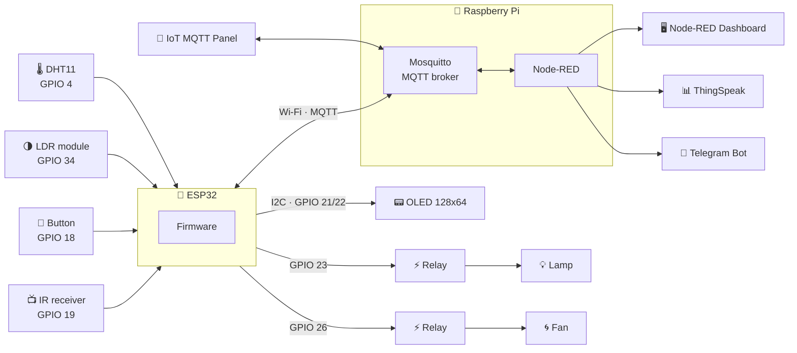

### Command flow: dashboard → lamp

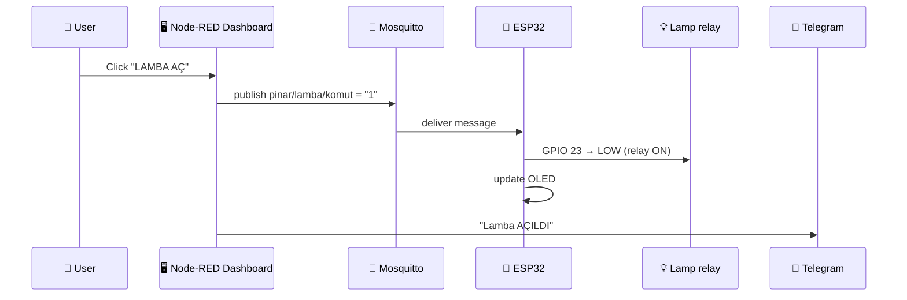

---

## 📡 MQTT Topics

| Topic | Direction | Payload | Description |
|---|:---:|---|---|
| `pinar/lamba/komut` | ⬇️ subscribe | `1` / `0` | Turn the lamp on / off |
| `pinar/fan/komut` | ⬇️ subscribe | `1` / `0` | Turn the fan on / off |
| `pinar/sicaklik` | ⬆️ publish | e.g. `24.6` | Temperature (°C) |
| `pinar/nem` | ⬆️ publish | e.g. `70.4` | Relative humidity (%) |
| `pinar/isik` | ⬆️ publish | `1` / `0` | `1` = dark, `0` = bright |

---

## 🔌 Pin Map

| ESP32 GPIO | Component | Notes |
|:---:|---|---|
| `23` | Lamp relay | Active-low output |
| `26` | Fan relay | Active-low output |
| `18` | Push button | `INPUT_PULLUP`, software debounce |
| `19` | IR receiver | `IRremote` library |
| `4` | DHT11 data | Temperature + humidity |
| `34` | LDR module (DO) | Digital light / dark output |
| `21` / `22` | OLED SDA / SCL | I2C, address `0x3C` |

<div align="center">
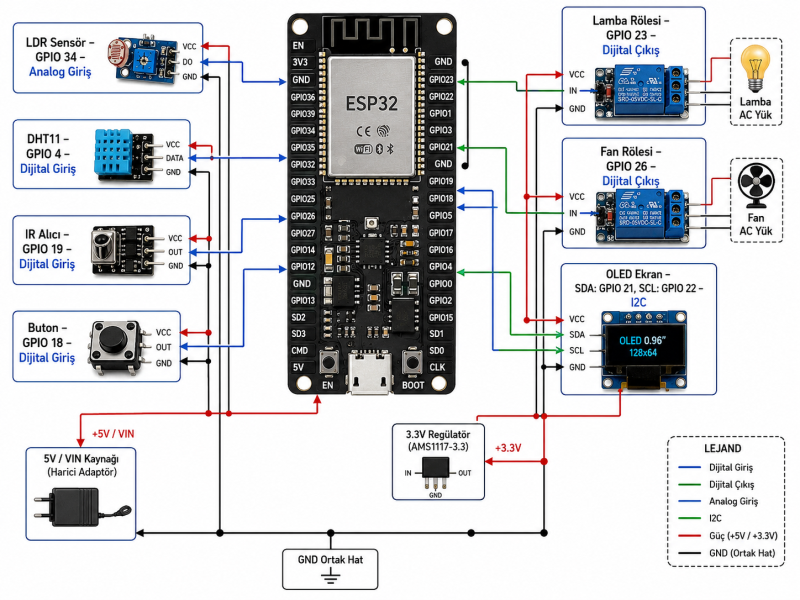
<br/><sub><i>Wiring diagram from the project report</i></sub>
</div>

---

## 🖼️ Gallery

### 🔧 Hardware

<table>
<tr>
<td width="33%" align="center">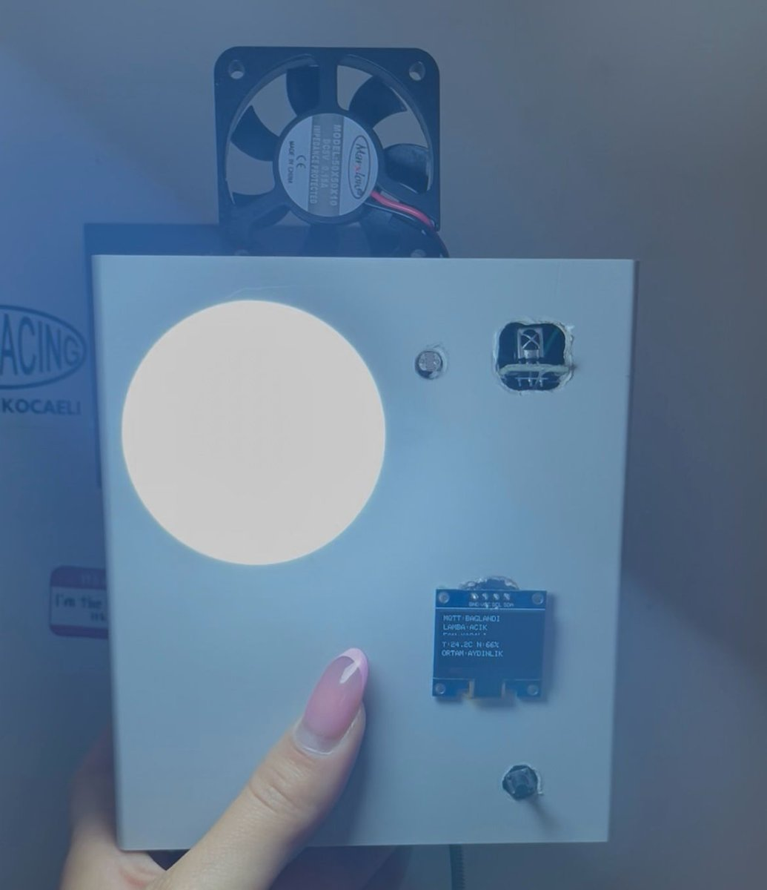<br/><sub><b>Lamp ON</b></sub></td>
<td width="33%" align="center">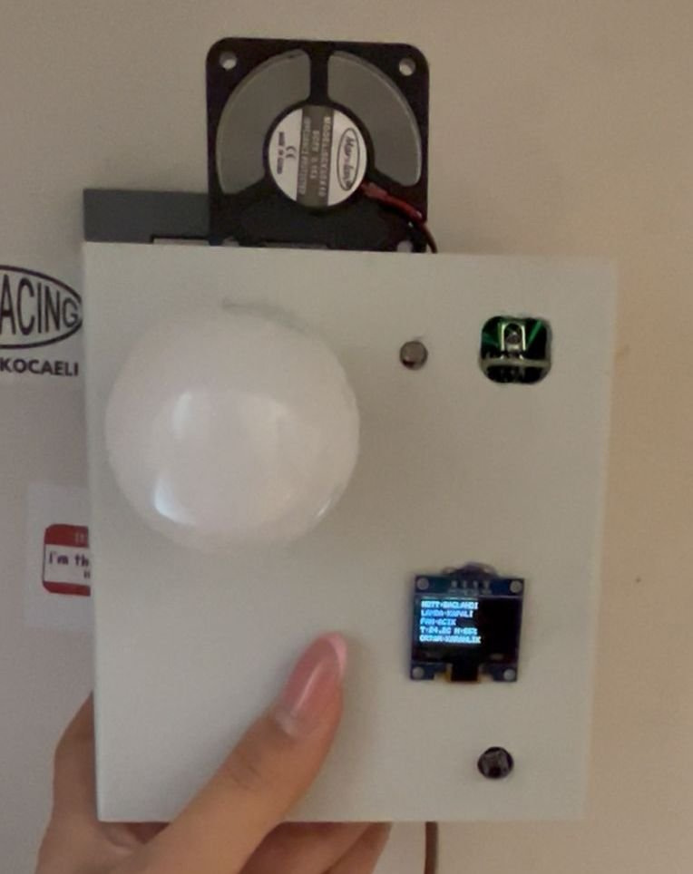<br/><sub><b>Lamp OFF</b></sub></td>
<td width="33%" align="center">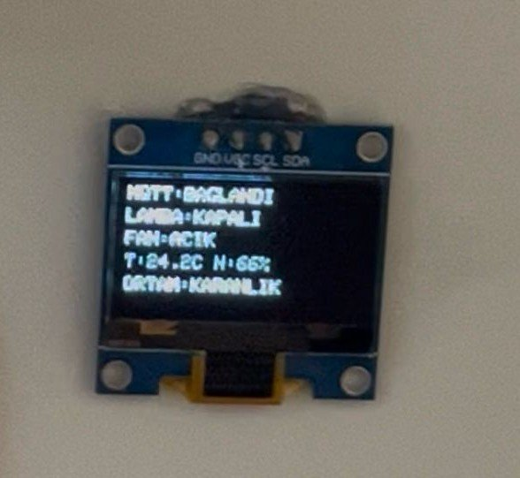<br/><sub><b>OLED status screen</b></sub></td>
</tr>
</table>

<div align="center">
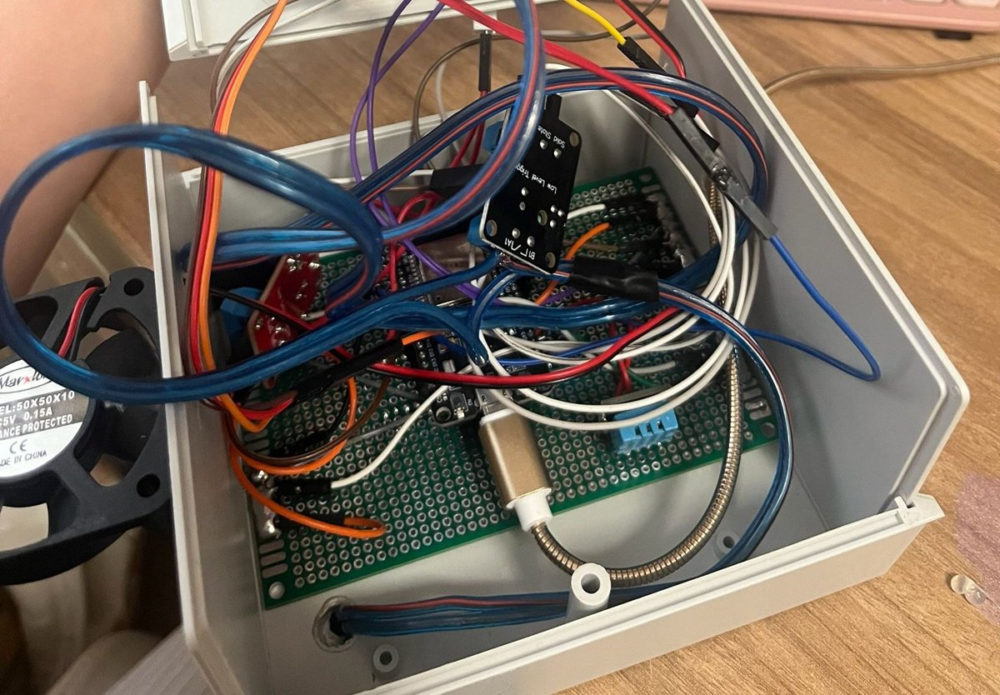<br/>
<sub><b>Inside the enclosure:</b> ESP32, relays and sensors soldered on perfboard</sub>
</div>

### 🖥️ Node-RED Dashboard (mobile view)

<table>
<tr>
<td width="25%" align="center">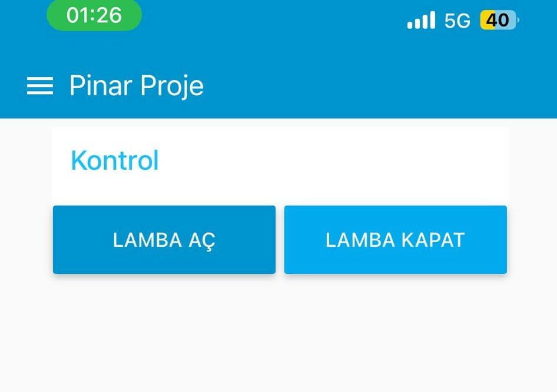<br/><sub><b>Lamp control</b></sub></td>
<td width="25%" align="center">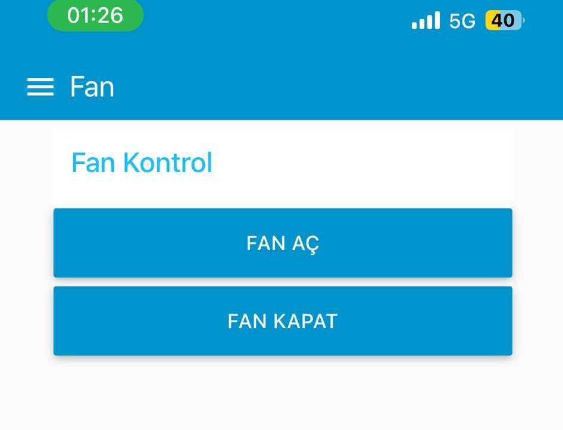<br/><sub><b>Fan control</b></sub></td>
<td width="25%" align="center">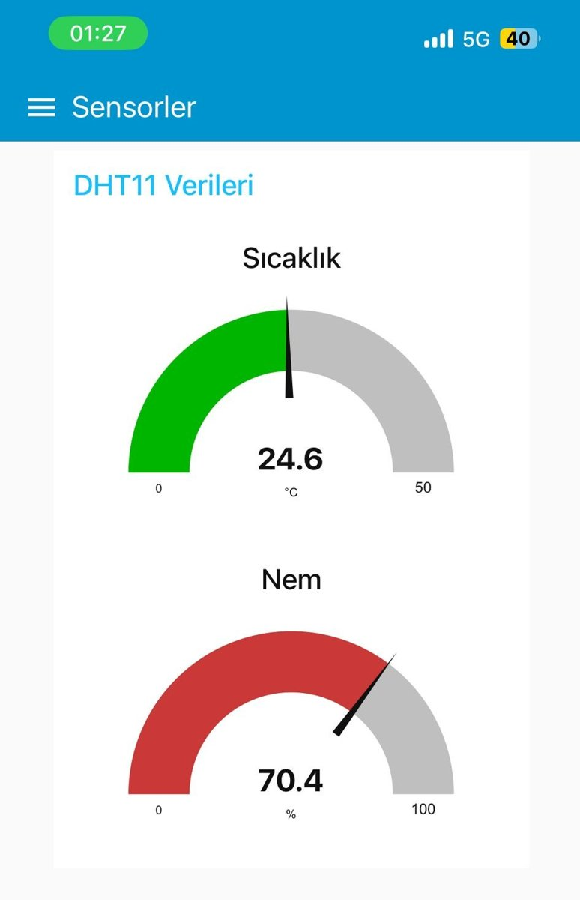<br/><sub><b>Temperature & humidity</b></sub></td>
<td width="25%" align="center">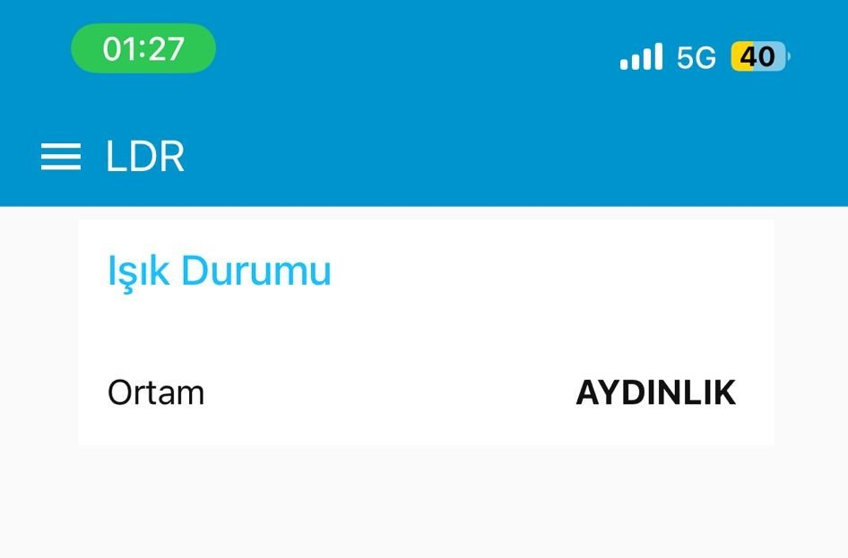<br/><sub><b>Ambient light</b></sub></td>
</tr>
</table>

### 📊 ThingSpeak & 🔔 Telegram

<table>
<tr>
<td width="60%" align="center">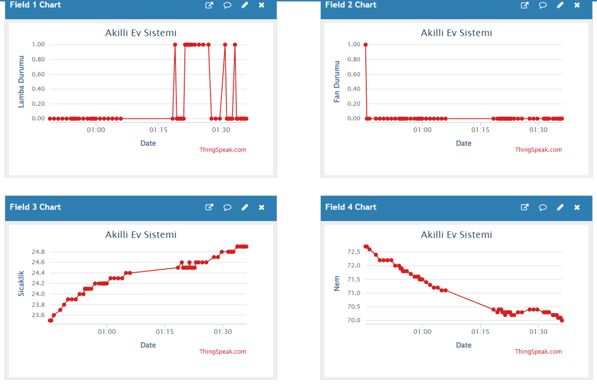<br/><sub><b>ThingSpeak:</b> lamp, fan, temperature and humidity history</sub></td>
<td width="40%" align="center"><br/><sub><b>Telegram</b> notifications</sub></td>
</tr>
</table>

<details>
<summary><b>🔀 Node-RED flows (click to expand)</b></summary>
<br/>

| Flow | Screenshot |
|---|---|
| Lamp control (inject + dashboard → MQTT + ThingSpeak) | 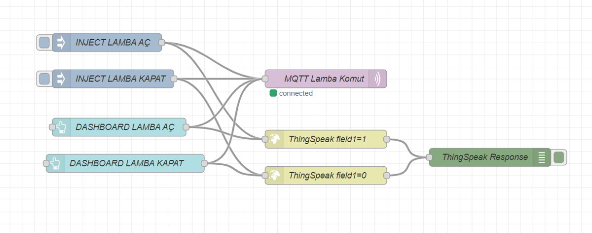 |
| Fan control | 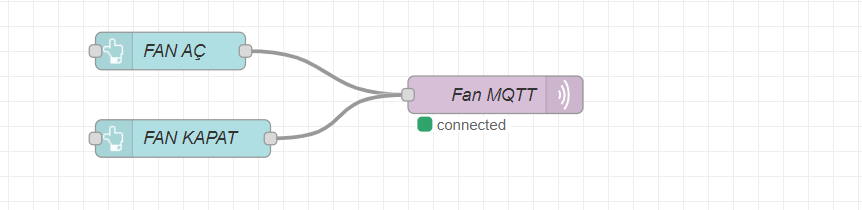 |
| DHT11 temperature & humidity | 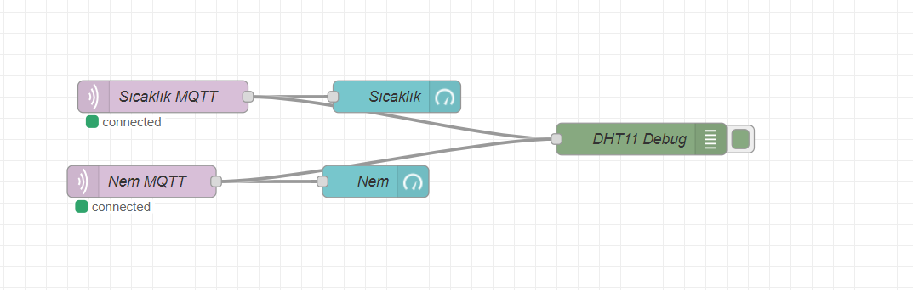 |
| LDR light state | 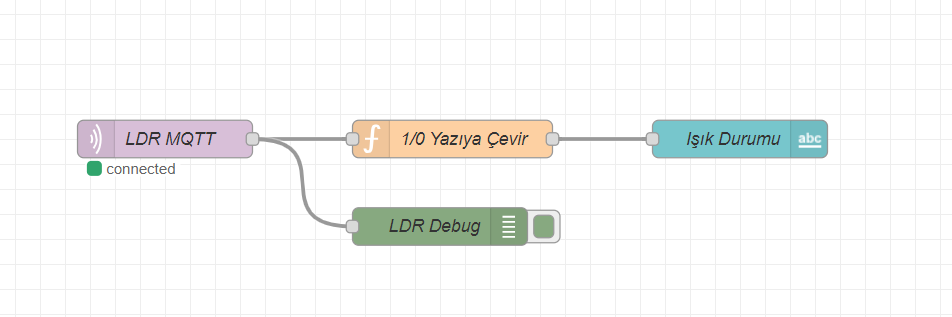 |
| ThingSpeak upload (every 20 s) | 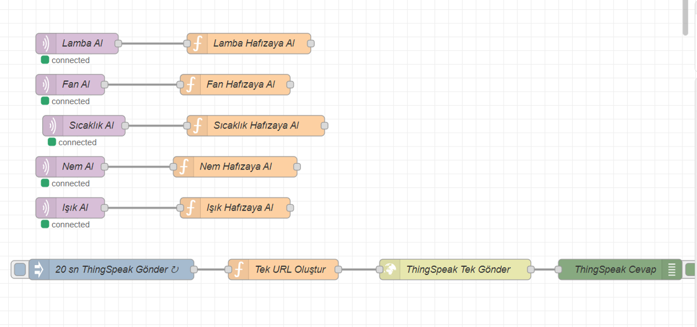 |
| Telegram notifications | 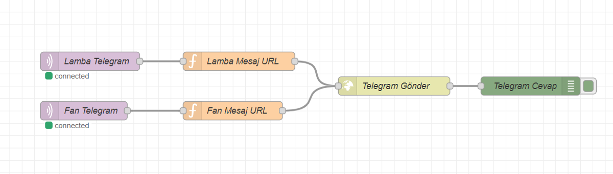 |
| ThingSpeak light level chart | 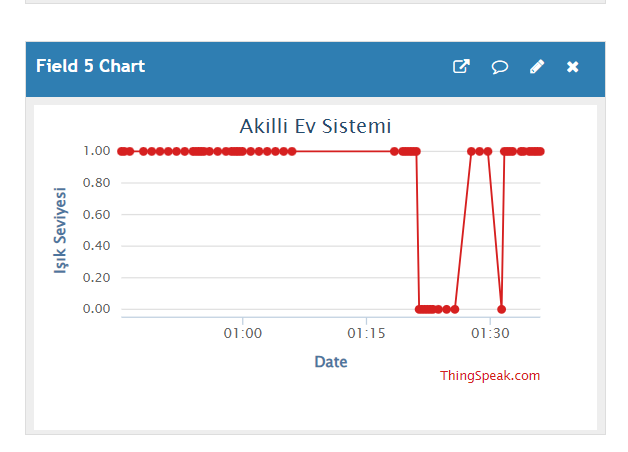 |

</details>

---

## 💻 Code Highlights

**MQTT command handler: one callback controls both loads**
```cpp
void callback(char* topic, byte* payload, unsigned int length) {
  String mesaj = "";
  for (unsigned int i = 0; i < length; i++) mesaj += (char)payload[i];
  mesaj.trim();

  if (String(topic) == topic_lamba_cmd) {
    if (mesaj == "1") setLamp(true);
    else if (mesaj == "0") setLamp(false);
  }
  if (String(topic) == topic_fan_cmd) {
    if (mesaj == "1") setFan(true);
    else if (mesaj == "0") setFan(false);
  }
}
```

**Non-blocking sensor publishing every 2 seconds with `millis()`**
```cpp
if (millis() - lastSensorTime >= 2000) {
  lastSensorTime = millis();
  float nem = dht.readHumidity();
  float sicaklik = dht.readTemperature();
  if (!isnan(nem) && !isnan(sicaklik)) {
    client.publish(topic_sicaklik, String(sicaklik, 1).c_str());
    client.publish(topic_nem,      String(nem, 1).c_str());
  }
  int isikDurumu = (digitalRead(LDR_PIN) == HIGH) ? 1 : 0;   // 1 = dark
  client.publish(topic_isik, String(isikDurumu).c_str());
}
```

**IR remote: each button code toggles a different load**
```cpp
if (IrReceiver.decode()) {
  uint32_t gelen = IrReceiver.decodedIRData.decodedRawData;
  if (gelen == irLampCode) toggleLamp();
  if (gelen == irFanCode)  toggleFan();
  IrReceiver.resume();
}
```

---

## 📁 Project Structure

```
iot-smart-outlet/
├── firmware/
│   └── iot_smart_outlet/
│       └── iot_smart_outlet.ino   # ESP32 firmware (Arduino IDE)
├── docs/
│   ├── IoT_Smart_Outlet_Report.pdf
│   └── IoT_Smart_Outlet_Report.docx
├── images/                        # photos, dashboards, flows
└── README.md
```

---

## 🚀 Getting Started

### 1. Raspberry Pi
```bash
sudo apt install mosquitto mosquitto-clients
bash <(curl -sL https://raw.githubusercontent.com/node-red/linux-installers/master/deb/update-nodejs-and-nodered)
```
In Node-RED, install **node-red-dashboard** from *Manage palette*, then build the lamp, fan, sensor, ThingSpeak and Telegram flows shown above.

### 2. ESP32
1. Open `firmware/iot_smart_outlet/iot_smart_outlet.ino` in **Arduino IDE** and select an **ESP32 Dev Module** board.
2. Install the libraries: **PubSubClient**, **IRremote**, **DHT sensor library**, **Adafruit GFX**, **Adafruit SSD1306**.
3. Fill in your own network details:
   ```cpp
   const char* ssid        = "YOUR_WIFI_SSID";
   const char* password    = "YOUR_WIFI_PASSWORD";
   const char* mqtt_server = "192.168.1.100";   // Raspberry Pi IP
   ```
4. Read your own remote's button codes from the Serial Monitor (`IR kod: ...`) and set `irLampCode` / `irFanCode`.
5. Upload and open the Serial Monitor at **115200 baud**.

### 3. Test
```bash
mosquitto_pub -h <PI_IP> -t pinar/lamba/komut -m 1   # lamp ON
mosquitto_sub -h <PI_IP> -t "pinar/#" -v              # watch all data
```

---


---

<div align="center">

👩‍💻 Developed by **[Pınar Ayer](https://github.com/Ayer8315)** · Engineering Design II · Electronics and Communication Engineering, Kocaeli University

</div>
